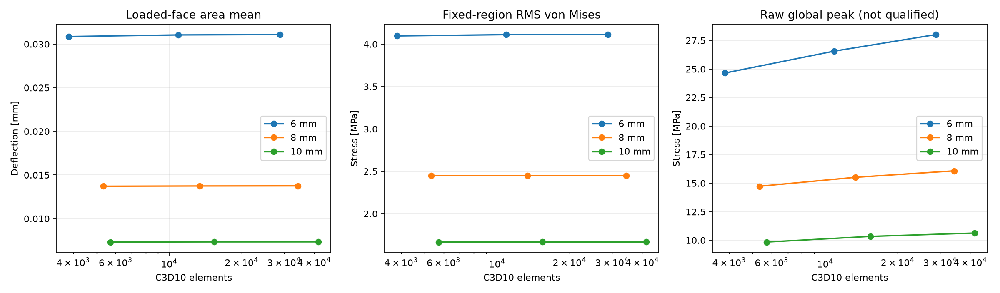

# OpenMechanical

[](https://github.com/harshavarthan6767/openmechanical/actions/workflows/verification.yml)

[Download the v0.1.0 preview](https://github.com/harshavarthan6767/openmechanical/releases/tag/v0.1.0) · [Install and use](docs/installation.md) · [Agent skill](skills/mechanical-fea/SKILL.md)

**An agent skill and reproducible CAD-to-FEA tools for cantilever and mounting-bracket verification.** Generate CAD with CadQuery, mesh it with Gmsh, run CalculiX, and retain the evidence behind every result. The CLI works without an LLM API key.

Status: **scoped engineering verification preview**. Numerical verification is implemented for the documented templates; production design approval remains unassessed. Read the [measured scope and limitations](docs/professional-readiness.md).



## Install the tools

Use Ubuntu 24.04 or Ubuntu under WSL2, Python 3.12, uv, and CalculiX 2.21. Follow the [installation guide](docs/installation.md) for system prerequisites and uv setup, then:

```bash
git clone https://github.com/harshavarthan6767/openmechanical.git
cd openmechanical
uv sync --locked --extra dev --python 3.12
uv run --no-sync openmechanical doctor --json
```

## Run the bracket study

```bash
uv run --no-sync openmechanical validate examples/mounting_bracket/problem.json --json
uv run --no-sync openmechanical compare examples/mounting_bracket/problem.json --thickness-mm 6 8 10 --out runs/first-study --json
```

Open `runs/first-study/report.html`. Every run needs a fresh output directory. The supplied example uses illustrative steel and a **295 N total resultant**, preserved across thicknesses by explicit traction adjustment.

| Command | What it does |
|---|---|
| `doctor` | Check dependencies and actual solver versions |
| `validate` | Check typed problem input and units |
| `prepare` | Generate bracket CAD, boundary preview and mesh |
| `run` | Execute one supported bracket or cantilever solve |
| `verify` | Run three meshes for one bracket |
| `compare` | Run a constant-force thickness study and report |

See the [tool reference](docs/tool-reference.md) for arguments, outputs, statuses and supported physics. A single completed solve can remain numerically incomplete. `verify` and `compare` return exit code 6 if required verification does not pass.

## Install and use the agent skill

The skill is in [skills/mechanical-fea](skills/mechanical-fea/SKILL.md). Install the tools first. In a Linux Codex environment, copy the skill from this checkout:

```bash
mkdir -p ~/.codex/skills
cp -R skills/mechanical-fea ~/.codex/skills/
export OPENMECHANICAL_PROJECT="$PWD"
```

Review an existing skill installation before replacing it. Reload the agent, point it at this checkout, and ask:

> Use $mechanical-fea to run the supplied illustrative bracket study for 6, 8 and 10 mm thicknesses. Use a fresh output directory and explain the actual numerical and design statuses.

For Windows Codex, copy the folder into your Windows `.codex/skills` directory and tell the agent to execute tools in your Ubuntu WSL distribution. The [installation guide](docs/installation.md#4-install-the-codex-skill) includes setup details and more prompts.

The skill uses the same tested CLI; installing a skill does not install CalculiX or Python dependencies. It requires terminal and filesystem access, and is not an MCP server.

## Measured evidence

All three candidates passed the declared geometry, equilibrium, displacement and regular-region stress checks across 4, 2.828427 and 2 mm meshes:

| Thickness | Mass | Finest mean deflection | Regular-region RMS stress |
|---:|---:|---:|---:|
| 6 mm | 0.334522 kg | 0.03109321 mm | 4.11319 MPa |
| 8 mm | 0.433432 kg | 0.01375357 mm | 2.44903 MPa |
| 10 mm | 0.529202 kg | 0.00733963 mm | 1.66653 MPa |

Inspect the [published evidence](docs/evidence/README.md), [sample HTML report](docs/evidence/report.html), [analytical cantilever benchmark](docs/benchmark-results.md), and [readiness assessment](docs/professional-readiness.md). Download the HTML report to view it locally; GitHub displays its source.

The raw global peak near the ideal clamp increases with refinement and remains unqualified. The fixed regular-region RMS does not replace whole-part strength assessment. No winning thickness or design-safety claim is produced.

## Related studies

- [NASA backward-facing-step CFD reproduction](studies/nasa-tmr-backstep-cfd/README.md) contains an OpenFOAM Foundation v14 case and an archived coarse baseline. The mesh-quality check and mass-balance pilot check passed, but residual convergence did not; its reattachment estimate also falls outside NASA's reported experimental interval. The study is incomplete and makes no validation claim.
- [Mesh-quality response pilot](studies/mesh-evidence-benchmark/README.md) reports 30 controlled cantilever mesh attempts. Twenty-nine samples passed equilibrium and one mesh was invalid. It does not recommend a minSICN cutoff: the tested probes reject some response-accurate meshes, and no over-limit response was observed to test false-safe detection.

Both are research studies separate from the supported CAD-to-FEA CLI above.

## Verify the installation

```bash
uv run --no-sync pytest -q
uv run --no-sync ruff check src tests examples
uv run --no-sync python examples/qualify_backend.py --out runs/backend-check
```

The local suite has 36 regression tests. The real backend qualification covers axial stress/displacement, rotated and translated geometry, double-load response and bending. CI also runs the bracket study, unit-equivalence replay and distribution checks.

## Scope and license

Supported execution is homogeneous isotropic small-displacement linear elasticity with C3D10 solids, one full fixed region and constant vector traction on supported planar faces. The bracket template uses downward -Z traction. Pressure, general STEP execution, contact/bolt preload, plasticity, fatigue, buckling and arbitrary assemblies are outside the qualified scope.

Source code and skill: [MIT license](LICENSE). CadQuery, Gmsh, CalculiX and other upstream dependencies retain their own licenses. The repository does not bundle the CalculiX executable.
